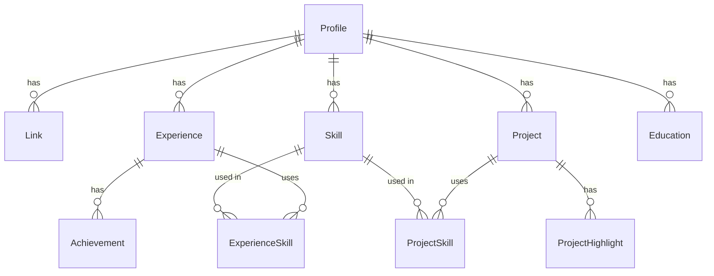

# CV GraphQL API — цифровая визитка Владимира

Backend-приложение, которое презентует меня как специалиста: профиль, опыт, навыки и проекты хранятся в PostgreSQL и отдаются через GraphQL. Открываете Apollo Sandbox и получаете визитку целиком одним запросом — со связями, поиском, подсказками и пагинацией.

**Стек:** TypeScript · Node.js 20 · NestJS 10 · GraphQL (Apollo Server 4, code-first) · Prisma 5 · PostgreSQL 16 · Redis · Docker · Jest · GitHub Actions

- **Стартовая страница** `/` — примеры запросов, которые выполняются прямо со страницы
- **Apollo Sandbox** `/graphql`
- **Проверка живости** `/health`

## Запуск

```bash
docker compose up --build
# http://localhost:3000 — стартовая страница, http://localhost:3000/graphql — Apollo Sandbox
```

При старте контейнер сам применяет миграции, заполняет базу моими данными и запускает сервер (`npm run start:prod`). Повторный запуск ничего не дублирует.

<details>
<summary>Без Docker</summary>

Нужны Node.js 20+ и PostgreSQL 14+ (Redis — по желанию).

```bash
cp .env.example .env          # укажите DATABASE_URL
npm ci
npx prisma migrate deploy
npm run db:seed
npm run start:dev
```
</details>

## Примеры запросов

```graphql
# Визитка целиком: любые связи любой глубины — без N+1
{
  profile {
    name
    headline
    links { kind url }
    totalExperience { years months }
    experience {
      company
      role
      achievements { text }
      skills { name }
    }
    projects { name demoUrl skills { name } }
  }
}
```

```graphql
# Полнотекстовый поиск по проектам и достижениям, с подсветкой
{ search(query: "синхронизация данных") { kind title snippet rank } }

# Подсказки навыков с допуском опечаток
{ suggestSkills(prefix: "opensaerch") { skill { name } score } }

# Проекты постранично, с фильтром по навыку
{ projects(first: 3, skill: "postgresql") { totalCount pageInfo { hasNextPage endCursor } edges { node { name } } } }

# Обратная связь: где применялся навык
{ skill(slug: "redis") { name projects { name } experience { company } } }

# Статистика, посчитанная агрегатами PostgreSQL
{ profile { stats(top: 5) { projects skills topSkills { skill { name } usageCount } } } }
```

Полная схема API — в [`schema.gql`](./schema.gql).

## Архитектура

```
Клиент (Apollo Sandbox)
   │ GraphQL
   ▼
Resolvers ── принимают аргументы, ничего не знают о SQL
   │               └── DataLoader: связи одним запросом на тип связи
   ▼
Services ─── бизнес-логика: пагинация, статистика, поиск, кэш
   │
   ▼
Prisma / $queryRaw ── типизированный доступ к PostgreSQL
   │
   ├── PostgreSQL 16: связи, индексы, tsvector + GIN, pg_trgm
   └── Redis (необязательно): кэш и ограничение частоты запросов
```

```
src/
  profile/   GraphQL-типы, резолверы, ProfileService (профиль, стаж, статистика, пагинация)
  search/    SearchService: полнотекстовый поиск и подсказки
  graphql/   DataLoader'ы, создаются на каждый запрос
  common/    чистые функции: стаж со слиянием периодов, keyset-курсор, rate limit
  cache/     Redis: cache-aside с версией данных, счётчики
  prisma/    PrismaService со счётчиком SQL-запросов
  health/    /health для платформы деплоя
prisma/
  schema.prisma, migrations/   схема и миграции (в т.ч. ручной SQL для FTS и pg_trgm)
  data/profile.ts              данные визитки — источник правды для сида
  seed.ts                      идемпотентный сид
test/
  unit/  чистые функции
  e2e/   API на настоящем PostgreSQL
```

### Схема базы данных



## Решения и почему так

**Code-first GraphQL.** Схема генерируется из TypeScript-классов: один источник правды для типов API и кода, без ручной синхронизации SDL и интерфейсов. Сгенерированный `schema.gql` лежит в репозитории, чтобы схему было удобно смотреть на ревью.

**Разделение ответственности.** Резолверы только разбирают аргументы и делегируют. Логика живёт в сервисах, связи загружают DataLoader'ы, SQL — только в сервисах и загрузчиках. Резолвер можно заменить REST-контроллером, не трогая логику.

**Вложенные данные без N+1 — DataLoader, а не `include`.** `include` в Prisma решает N+1, только если заранее известно, какие связи запросит клиент. В GraphQL клиент сам выбирает поля и глубину, поэтому связи грузятся DataLoader'ами: все обращения к одной связи за один тик склеиваются в `WHERE fk IN (...)`. Загрузчики создаются на каждый запрос, кэш не протекает между пользователями. E2E-тест добавляет 20 проектов и проверяет, что **число SQL-запросов не изменилось**.

**Поиск средствами PostgreSQL.** Для визитки отдельный поисковый движок избыточен, PostgreSQL справляется сам:
- `tsvector`-колонки генерирует база (`GENERATED ALWAYS … STORED`) с русской и английской морфологией. У проектов название весит больше описания (`setweight`);
- GIN-индексы, ранжирование `ts_rank`, подсветка совпадений `ts_headline`;
- двухступенчатый поиск: сначала все слова запроса, и только если пусто — любое из слов, чтобы точные совпадения не тонули среди частичных;
- подсказки навыков на `pg_trgm` с GIN-индексом: сначала совпадения по началу названия, затем похожие по триграммам. «opensaerch» находит OpenSearch.

Prisma не умеет описывать сгенерированные колонки, поэтому они созданы ручным SQL в миграции, а в `schema.prisma` объявлены как `Unsupported("tsvector")`.

**Keyset-пагинация вместо OFFSET.** Курсор кодирует пару `(position, id)`, индекс `(profileId, position, id)` её покрывает. Цена страницы не растёт с её номером, записи не задваиваются при вставках между запросами. Берём `first + 1` строку, чтобы узнать `hasNextPage` без отдельного запроса. Курсор непрозрачен для клиента, а подделанный отклоняется с кодом 400.

**Статистика в базе.** «Самые используемые навыки» и счётчики по категориям считаются `GROUP BY` в PostgreSQL одним проходом, а не перебором записей в Node.

**Инициализация базы — идемпотентный сид.** Данные лежат в `prisma/data/profile.ts`, сид приводит базу к этому состоянию при каждом старте:
- записи ищутся по стабильным ключам (`slug`) и обновляются через `upsert`;
- то, чего больше нет в данных, удаляется;
- всё выполняется в одной транзакции;
- хэш данных хранится в `SeedState`: если данные не менялись, сид пропускается.

Перед записью сид проверяет данные: нет ли повторяющихся slug и ссылок на несуществующие навыки.

**Redis — необязательный.** Cache-aside для профиля и статистики. Ключи включают версию данных (хэш сида): после обновления данных старый кэш просто перестаёт читаться и истекает сам, без обхода ключей. Там же ограничение частоты запросов (фиксированное окно, `INCR` + `EXPIRE`). Без `REDIS_URL` всё работает напрямую с базой, а ошибки Redis не роняют запросы.

**Защита API.**
- Ограничение глубины запроса (8 уровней): циклические связи навык ↔ проект не дают построить «бесконечный» запрос.
- Лимиты на `first`, `limit` и длину поискового запроса.
- Все параметры SQL передаются плейсхолдерами `$queryRaw`.
- Ошибки клиента (400, 404) отдаются с понятным текстом, а внутренние в продакшене — без деталей реализации.

**Стаж без двойного счёта.** `totalExperience` сливает пересекающиеся и смежные периоды работы и считает месяцы по объединению. Периоды без точных дат не ломают расчёт и учитываются отдельным полем.

## Что я уже делал в продакшене

В HR-tech я работал над поиском кандидатов по базе из 15+ млн профилей (NestJS, PostgreSQL, OpenSearch, Redis). Часть решений здесь перенесена оттуда в уменьшенном виде:

| HR-tech | Здесь |
|---|---|
| Синхронизация PostgreSQL → OpenSearch с keyset-пагинацией по `("syncAt", id)` пачками по 10 000 | Keyset-пагинация проектов по `(position, id)` |
| Идемпотентный backfill 30+ млн документов: upsert по `_id`, повторный запуск безопасен | Идемпотентный сид: upsert по slug, транзакция, удаление лишнего |
| Watermark в Redis: граница последней обработки, повторно не обрабатываем | Хэш версии данных: неизменённые данные не перезаписываются, кэш инвалидируется сменой версии |
| Подсказки на edge-ngram и частотные индексы навыков, должностей, компаний | Подсказки на `pg_trgm` и частотность навыков через `GROUP BY` |
| Расчёт суммарного стажа со слиянием пересекающихся интервалов | `totalExperience` с тем же алгоритмом |
| Полнотекстовый поиск в OpenSearch | Полнотекстовый поиск на `tsvector` + GIN |

## Тесты

```bash
npm run test:unit                                     # чистые функции
DATABASE_URL=postgresql://…/cv_test npm run test:e2e  # API на настоящем PostgreSQL
```

E2E проверяют:
- идемпотентность сида (повторный запуск не создаёт дублей);
- отсутствие N+1;
- обход всех страниц без пропусков и повторов;
- фильтры, поиск и подсказки;
- коды ошибок 400 и 404;
- отклонение слишком глубоких запросов.

CI (GitHub Actions) на каждый пуш: проверка типов, юнит-тесты, миграции и e2e на PostgreSQL 16, сборка Docker-образа.

## Деплой

В репозитории есть [`render.yaml`](./render.yaml): Render → New → Blueprint → этот репозиторий, ветка `cv-graphql`. Будут созданы веб-сервис из Dockerfile, PostgreSQL и Redis. Миграции и заполнение базы выполнятся при старте контейнера.
