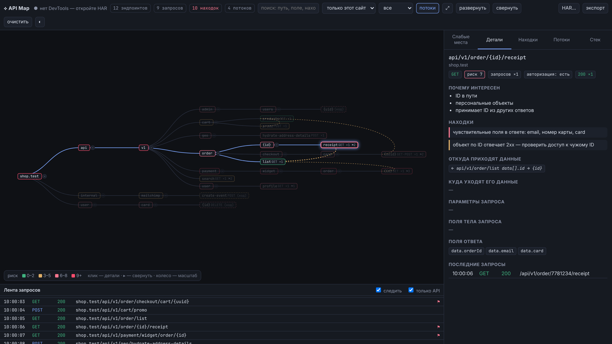

# API Map — расширение для Chrome / Edge

Живая карта API сайта по вашему собственному трафику: дерево эндпоинтов, потоки ID между запросами,
пассивные находки. Ничего не отправляет само — только наблюдает запросы, которые браузер и так делает.

## Установка
1. `chrome://extensions` → включить «Режим разработчика».
2. «Загрузить распакованное» → выбрать папку `apimap-ext`.
3. Открыть сайт → DevTools (F12) → вкладка **API Map**.
4. Совет: в Network включите **Disable cache**, иначе ответы 304 приходят без тела и потоки ID не видны.

## Что умеет
- Дерево `хост → путь`, растёт в реальном времени; цвет рамки — максимальный риск в ветке,
  пунктир — эндпоинт найден только в JS (ещё не вызывался).
- Клик по узлу — детали и подсветка окружения: откуда пришли данные, куда уходят. `+/−` — свернуть.
- Лента запросов; клик — полный запрос/ответ, стек вызова, JWT. Секреты в заголовках маскируются.
- Находки: персональные данные в ответах, данные без авторизации, объекты по ID, стеки/ошибки БД,
  CORS с credentials, секреты в URL, GraphQL.
- Вкладка «Стек»: сервер, шлюзы (Kong, Envoy…), JWT с расшифровкой.
- Данные хранятся локально по сайту; импорт HAR, экспорт модели в JSON.

## Виды
- **дерево** — эндпоинты по сегментам пути.
- **потоки** — граф: стрелка «ответ A → параметр B» с подписью поля (`data[].id → {id}`). Узлы можно таскать.
- **страницы** — какие API вызывает каждая страница сайта; клик по странице подсвечивает её запросы.

## Повтор запроса с правкой
В деталях запроса — «↻ повторить с правкой»: метод, URL, заголовки, тело; можно отправить без кук сайта.
Запрос выполняется из контекста страницы (как если бы его сделал сам сайт), результат сравнивается с
оригиналом (статус, размер, отличия JSON). **Работает только для доменов из списка в ⚙** — добавляйте
туда лишь сайты, которые вам разрешено тестировать. Там же — заголовки, которые добавляются к каждому повтору.

`panel.html` можно открыть и как обычную страницу — тогда работает только импорт HAR.
